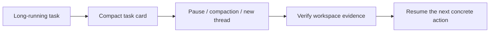

# Task Continuity: Long-Running AI Agent Task Handoff Skill

[English](#english) | [简体中文](#简体中文)

[](LICENSE)
[](https://agentskills.io/specification)
[](#installation)
[](#installation)
[](#installation)

An instruction-only Agent Skill for keeping long-running work resumable across pauses, context compaction, and thread handoffs.

一个仅包含指令的 Agent Skill，用于让长时间、多阶段任务在暂停、上下文压缩或会话交接后仍可恢复。

> Looking for a way to resume a long-running AI coding task, recover a task after context compaction, or hand unfinished work to a new thread? This skill is designed for that problem.
>
> 想恢复被上下文压缩打断的长任务、让新线程继续未完成的工作，或避免 AI Agent 重复已经做过的事情？这个 Skill 面向的正是这类问题。



---

## English

### Overview

Task Continuity maintains a compact, evidence-backed task card instead of attempting to preserve an entire conversation. It helps an agent decide when continuity management is useful, where one task should end, how to hand work off, and how to recover from verified workspace evidence.

This repository contains instructions and UI metadata only. There is no server to start, no dependency installation, and no build step.

### Why Task Continuity?

Long-running agent sessions often fail at boundaries rather than inside individual commands:

- the original objective and completion criteria are lost after compaction;
- completed work and failed approaches are rediscovered;
- a new thread starts without the decisions that are still in force;
- a summary claims work is complete when the workspace says otherwise.

Task Continuity keeps only the verified state that changes future action, so an agent can continue instead of restarting.

### Common search intents

This skill is for tasks such as:

- "resume a long-running Codex task after context compaction";
- "hand off unfinished work to a new Claude Code thread";
- "keep AI agent task state across sessions";
- "prevent duplicate work after an agent runs out of context";
- "create a compact task handoff for Codex, WorkBuddy, or DeepSeek Harness".

### Features

- Maintains one `TASK_CARD.md` with a separate section for each active delivery.
- Records completion criteria, verified evidence, next actions, constraints, and unresolved risks.
- Distinguishes continuation, independent delivery, and unrelated-task boundaries.
- Produces compact handoffs without copying the full conversation.
- Reconciles recovery claims against current files, diffs, tests, and artifacts.
- Explicitly excludes secrets, access tokens, private keys, and sensitive logs from task cards.
- Avoids unnecessary task cards for simple Q&A and single-turn edits.

### Repository structure

```text
task-continuity/
├── SKILL.md             # Skill metadata and complete workflow instructions
├── agents/
│   └── openai.yaml      # Display name, short description, and default prompt
├── .gitignore           # Excludes secrets, local state, dependencies, and outputs
├── LICENSE              # MIT license
└── README.md            # Bilingual project documentation
```

### Requirements

Use a host that supports the Agent Skills format. No programming language runtime or third-party package is required by the skill itself.

### Installation

Install the complete directory under the skill root used by your host:

| Host | User-level root | Project-level root | Invocation |
|---|---|---|---|
| Codex | `$CODEX_HOME/skills/task-continuity/` (default: `~/.codex/skills/task-continuity/`) | Use the host's project skill root where supported | `$task-continuity` |
| Claude Code | `~/.claude/skills/task-continuity/` | `.claude/skills/task-continuity/` | `/task-continuity` |
| WorkBuddy / CodeBuddy | `~/.codebuddy/skills/task-continuity/` | `.codebuddy/skills/task-continuity/` | Skill picker or `/task-continuity` when slash invocation is enabled |
| DeepSeek Harness | `~/.dsh/skills/task-continuity/` or `~/.agents/skills/task-continuity/` | `.dsh/skills/task-continuity/` or `.agents/skills/task-continuity/` | `/task-continuity` |
| Other Agent Skills hosts | The host's documented skill root, or `~/.agents/skills/task-continuity/` when it supports the shared root | `<project>/.agents/skills/task-continuity/` when supported | Host-specific; otherwise load `SKILL.md` explicitly |

Create the parent directory before cloning into a user-level root.

macOS or Linux:

```bash
export SKILLS_ROOT="$HOME/.codex/skills"
mkdir -p "$SKILLS_ROOT"
git clone https://github.com/han719307-dotcom/task-continuity.git "$SKILLS_ROOT/task-continuity"
```

Windows PowerShell:

```powershell
$skillsRoot = Join-Path $HOME ".codex\skills"
New-Item -ItemType Directory -Force $skillsRoot | Out-Null
git clone https://github.com/han719307-dotcom/task-continuity.git (Join-Path $skillsRoot "task-continuity")
```

Replace `SKILLS_ROOT` / `$skillsRoot` with the root for another host from the table. Reopen or restart the host if the skill does not appear.

`agents/openai.yaml` is Codex-specific; other hosts ignore it and read `SKILL.md`. WorkBuddy's managed skill editor additionally expects `agent_created: true` in the installed copy's frontmatter. Add that field only to a WorkBuddy-managed copy so the repository's canonical `SKILL.md` remains valid for Codex and other hosts.

### Usage

There is no standalone startup command. After installation, use the host's invocation form or ask the host to apply the skill:

```text
$task-continuity
```

Or include it in a request:

```text
Use $task-continuity to maintain a compact task card and verify where this long-running task should continue.
```

Use `/task-continuity` in Claude Code, DeepSeek Harness, and slash-command-enabled WorkBuddy sessions. If a host has no skill loader, provide its `SKILL.md` as an attached or project instruction file.

Hosts can also select the skill automatically when a task matches the description in `SKILL.md`. Use the host's skill selector to confirm that it is available.

Typical scenarios include migrations, refactors, releases, research followed by implementation, long verification, and work that must survive a pause or handoff. It is not intended for simple Q&A, one-command checks, or edits completed in one turn unless continuity is explicitly requested.

If this solves a problem you have hit, add a GitHub star to make the project easier for other agent users to discover.

### Validation

1. Confirm that `SKILL.md` contains `name` and `description` in its YAML frontmatter.
2. Confirm that `agents/openai.yaml` contains the intended display metadata.
3. Open the Codex skill selector and verify that **Task Continuity** appears.
4. Invoke `$task-continuity` on a multi-phase task and check that the resulting task card is concise, current, and supported by workspace evidence.

The project currently has no automated test suite because it contains no executable code.

### Security and local state

Do not store credentials, private keys, personal data, or complete sensitive logs in `TASK_CARD.md`, `SKILL.md`, or repository metadata. The root `.gitignore` excludes common secret files, local configuration, dependency directories, build outputs, and the local task card. Review the staged file list before every commit.

### Contributing

Keep the skill focused on continuity management. Preserve its concise task-card format, evidence-first recovery workflow, and instruction-only design. Update both language sections of this README when user-facing behavior or installation steps change.

### License

This project is available under the [MIT License](LICENSE).

---

## 简体中文

### 项目简介

Task Continuity 通过简短且有证据支撑的任务卡保存会影响后续行动的状态，而不是试图保留整段对话。它帮助智能体判断何时需要管理任务连续性、如何划分任务边界、如何交接，以及如何根据工作区证据恢复任务。

本仓库仅包含指令和界面元数据，不需要启动服务、安装依赖或执行构建。

### 为什么需要 Task Continuity？

长时间运行的 Agent 会话通常不是败在单条命令，而是败在任务边界：

- 上下文压缩后忘记最初目标和完成标准；
- 重新探索已经完成的工作或已经排除的方案；
- 新线程不知道此前已经确认的决定和约束；
- 摘要声称任务已经完成，但工作区实际情况并不一致。

Task Continuity 只保存会影响后续行动且已被验证的状态，让 Agent 接着做，而不是从头开始。

### 常见搜索需求

这个 Skill 适用于寻找以下能力的人：

- “上下文压缩后恢复 Codex 长任务”；
- “把未完成任务交接给新的 Claude Code 线程”；
- “让 AI Agent 跨会话保留任务状态”；
- “避免 Agent 因上下文不足重复已完成的工作”；
- “为 Codex、WorkBuddy 或 DeepSeek Harness 生成精简任务交接”。

### 主要功能

- 使用一份 `TASK_CARD.md`，并为每个活动交付维护独立的任务卡段落。
- 记录完成标准、已验证证据、下一步行动、约束和未解决风险。
- 区分同一交付的延续、独立交付和无关任务的边界。
- 生成交接摘要，避免复制整段对话。
- 恢复任务时，根据当前文件、差异、测试和产物核验既有结论。
- 明确禁止在任务卡中记录密钥、访问令牌、私钥和敏感日志。
- 避免为简单问答和单轮即可完成的小修改创建不必要的任务卡。

### 项目结构

```text
task-continuity/
├── SKILL.md             # Skill 元数据与完整工作流说明
├── agents/
│   └── openai.yaml      # 显示名称、简短说明和默认提示词
├── .gitignore           # 排除密钥、本地状态、依赖和构建产物
├── LICENSE              # MIT 许可证
└── README.md            # 中英文双语项目文档
```

### 环境要求

需要支持 Agent Skills 格式的宿主。Skill 本身不依赖编程语言运行时或第三方软件包。

### 安装方式

将完整目录安装到目标宿主使用的 Skill 根目录：

| 宿主 | 用户级目录 | 项目级目录 | 调用方式 |
|---|---|---|---|
| Codex | `$CODEX_HOME/skills/task-continuity/`（默认：`~/.codex/skills/task-continuity/`） | 使用宿主支持的项目级 Skill 目录 | `$task-continuity` |
| Claude Code | `~/.claude/skills/task-continuity/` | `.claude/skills/task-continuity/` | `/task-continuity` |
| WorkBuddy / CodeBuddy | `~/.codebuddy/skills/task-continuity/` | `.codebuddy/skills/task-continuity/` | Skill 选择器，或启用斜杠调用时使用 `/task-continuity` |
| DeepSeek Harness | `~/.dsh/skills/task-continuity/` 或 `~/.agents/skills/task-continuity/` | `.dsh/skills/task-continuity/` 或 `.agents/skills/task-continuity/` | `/task-continuity` |
| 其他 Agent Skills 宿主 | 宿主文档指定的目录；支持共享目录时可用 `~/.agents/skills/task-continuity/` | 支持时使用 `<project>/.agents/skills/task-continuity/` | 取决于宿主，或显式加载 `SKILL.md` |

用户级安装前需要先创建父目录。

macOS 或 Linux：

```bash
export SKILLS_ROOT="$HOME/.codex/skills"
mkdir -p "$SKILLS_ROOT"
git clone https://github.com/han719307-dotcom/task-continuity.git "$SKILLS_ROOT/task-continuity"
```

Windows PowerShell：

```powershell
$skillsRoot = Join-Path $HOME ".codex\skills"
New-Item -ItemType Directory -Force $skillsRoot | Out-Null
git clone https://github.com/han719307-dotcom/task-continuity.git (Join-Path $skillsRoot "task-continuity")
```

将 `SKILLS_ROOT` / `$skillsRoot` 替换为上表中目标宿主的目录。如果安装后没有显示，请重新打开或重启宿主。

`agents/openai.yaml` 仅用于 Codex；其他宿主会忽略它并读取 `SKILL.md`。WorkBuddy 的托管 Skill 编辑器还要求安装副本的 frontmatter 包含 `agent_created: true`。只应在 WorkBuddy 托管的副本中添加该字段，确保仓库中的标准 `SKILL.md` 仍能被 Codex 和其他宿主校验。

### 使用与启动

本项目没有独立的启动命令。安装后，使用宿主的调用形式，或要求宿主应用该 Skill：

```text
$task-continuity
```

也可以直接在请求中使用：

```text
Use $task-continuity to maintain a compact task card and verify where this long-running task should continue.
```

在 Claude Code、DeepSeek Harness 和支持斜杠命令的 WorkBuddy 会话中可使用 `/task-continuity`。如果宿主没有 Skill 加载器，可将 `SKILL.md` 作为附件或项目指令文件提供。

当任务符合 `SKILL.md` 中的描述时，宿主也可以自动选择此 Skill。可通过对应宿主的 Skill 选择器确认它是否可用。

典型场景包括迁移、重构、发布、先研究后实施、长时间验证，以及需要跨暂停或交接继续的工作。除非用户明确要求管理连续性，否则它不适用于简单问答、单命令检查或单轮完成的修改。

如果这个项目解决了你遇到的问题，可以添加一个 GitHub Star，让更多 Agent 用户更容易发现它。

### 验证方法

1. 确认 `SKILL.md` 的 YAML frontmatter 包含 `name` 和 `description`。
2. 确认 `agents/openai.yaml` 包含预期的显示元数据。
3. 打开 Codex Skill 选择器，确认能看到 **Task Continuity**。
4. 在一个多阶段任务中调用 `$task-continuity`，检查生成的任务卡是否精简、最新且有工作区证据支撑。

由于项目不包含可执行代码，目前没有自动化测试套件。

### 安全与本地状态

不要在 `TASK_CARD.md`、`SKILL.md` 或仓库元数据中保存凭据、私钥、个人数据或完整敏感日志。根目录 `.gitignore` 已排除常见密钥文件、本地配置、依赖目录、构建产物和本地任务卡。每次提交前仍应检查暂存文件清单。

### 贡献说明

请让 Skill 始终聚焦于任务连续性管理，保留精简任务卡、证据优先的恢复流程和纯指令设计。用户可见行为或安装步骤发生变化时，请同步更新本 README 的中英文部分。

### 许可证

本项目使用 [MIT 许可证](LICENSE)。

---

## References / 参考资料

- [OpenAI: Build skills](https://developers.openai.com/codex/build-skills)
- [Agent Skills specification](https://agentskills.io/specification)
- [Claude Code: Extend Claude with skills](https://code.claude.com/docs/en/skills)
- [DeepSeek Harness repository](https://github.com/deepseek-ai/deepseek-harness)
- [DeepSeek Harness documentation](https://deepseek-harness.github.io/deepseek-harness/)
